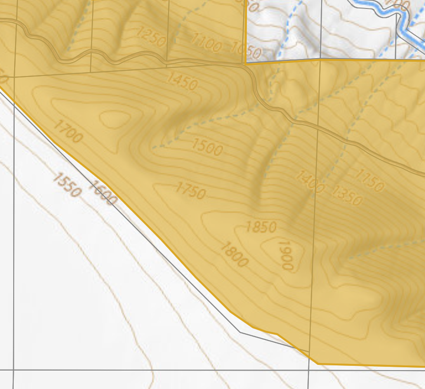
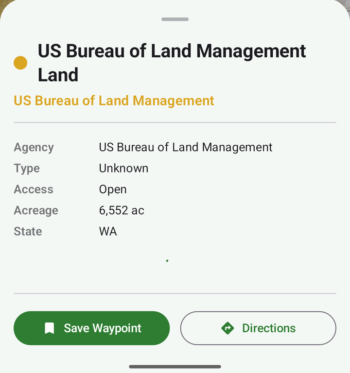

# Public Land Map

An Android map for hunting and hiking in Washington and Oregon. It shows a USGS topo basemap with parcel lines, colors public land by managing agency, and opens a detail sheet when you tap a parcel or a piece of public land. It also has search, waypoints, track recording, a measuring tool and GPX export.

The app is Kotlin with Jetpack Compose, MapLibre, Room and Hilt. The backend is a Kotlin/Ktor API on PostGIS, with Martin serving vector tiles. I built it to see how much of a commercial land-ownership map I could put together from public data.

| Public land colored by agency | Tap-for-detail sheet |
|---|---|
|  |  |

## Status

This is a working prototype, not a finished app.

What I have seen work on a device (April 2026, against a local backend loaded with Washington data):

- The USGS topo basemap.
- The public land overlay, colored by agency, and its tap-for-detail sheet.
- The parcel layer and its detail sheet.

What compiles and is wired up, but I have not confirmed end to end:

- Offline region downloads and the on-device tile server.
- Track recording, waypoints, the measuring tool, the compass and GPX export.
- The roads, trails, campground, trailhead and PLSS layers.

What does not work yet:

- The fire restriction, area closure and OHV layers. The database tables and API routes exist, but nothing loads data into them.
- Oregon is only partly covered. The Oregon public land loader works from a third-party copy of PAD-US, and I have not checked the Oregon parcel download.
- There is no release build. The release type has no signing configuration.

In the April 2026 screenshots the detail sheet shows "Type: Unknown" for a Bureau of Land Management polygon. The designation type is not mapped for every source.

Checked during the public-release cleanup (November 2026): the debug APK builds, 32 app unit tests pass, and 18 backend tests pass. That was on Windows 10 with JDK 17. Linux and macOS are untested. The backend tests do not need a database, so the SQL in the repositories is not covered by any automated test.

**The data loaders are unverified.** I checked each loader's source URL and field names against the live services' public layer metadata on 4 November 2026, and fixed the URLs that had died. I did not start the Docker stack, so the import SQL, the compose file and the Martin config have never run together since the rename and the rewrite. One source is still unconfirmed: there is no known public statewide Oregon tax lot service, so Oregon parcels load only if you supply a layer (see `backend/README.md`).

## Requirements

For the app:

- JDK 17
- Android SDK with platform 34 (set `ANDROID_HOME`, or put `sdk.dir=...` in `local.properties`)
- An emulator or a phone running Android 8.0 (API 26) or newer

For the backend and data loaders:

- Docker with Compose v2
- GDAL (`ogr2ogr`), `psql`, `curl` and Python 3
- [tippecanoe](https://github.com/felt/tippecanoe), only for the tile-building steps

Disk and time: loading all of Washington and Oregon needs tens of gigabytes and several hours. `backend/README.md` has the details.

## Build and run

### App

```bash
./gradlew assembleDebug
```

The APK is `app/build/outputs/apk/debug/app-debug.apk`. The debug build's application ID is `com.connorhansen.publiclandmap.debug`.

The app finds the backend at `http://10.0.2.2:8080` (API) and `http://10.0.2.2:3000` (tiles). That address is the emulator's alias for the host machine. The compose file publishes the backend ports on the host's loopback interface only (`127.0.0.1`), and the emulator reaches them through that alias. To point the app elsewhere, set a Gradle property or an environment variable at build time:

```bash
./gradlew assembleDebug -PapiBaseUrl=http://localhost:8080 -PtileBaseUrl=http://localhost:3000
# or PLM_API_BASE_URL and PLM_TILE_BASE_URL
```

On a physical phone, use `adb reverse` with the `localhost` URLs above. The reversed ports lead to the same loopback-only ports on your computer:

```bash
adb reverse tcp:8080 tcp:8080
adb reverse tcp:3000 tcp:3000
```

Cleartext HTTP is only allowed for `10.0.2.2`, `127.0.0.1` and `localhost`. Any other host needs HTTPS.

No map key is needed. The basemaps are USGS National Map, OpenStreetMap and OpenTopoMap raster tiles, and place search uses the public Nominatim service. Those services have usage limits (see Data sources), so they are fine for development and not for a published app.

### Backend

```bash
cd backend
cp .env.example .env      # set PG_PASSWORD (it is blank on purpose; compose refuses to start without one)
docker compose up -d      # PostGIS, Martin and the API
cd data-pipeline
./run-pipeline.sh         # download, import and tile the data
```

The pipeline downloads everything at setup time. No data is stored in this repository. See `backend/README.md` for each step, the environment variables and troubleshooting.

To run the API without Docker, start PostGIS yourself, then:

```bash
cd backend/api-server
./gradlew buildFatJar
DB_PASSWORD=... java -jar build/libs/public-land-map-api.jar   # DATABASE_URL and DB_USER are optional
```

## Tests

```bash
./gradlew testDebugUnitTest            # 32 app unit tests
cd backend/api-server && ./gradlew test   # 18 backend tests, no database needed
```

The app tests cover distance and area math, coordinate formatting, agency classification, the GPX writer and a mapper. The backend tests cover bounding box parsing, parameter checks on the parcel, public land and regulation routes, the parcel privacy guards and the health check. The offline and metadata routes have no tests. They do not cover repository SQL, view models, the Compose UI or the shell scripts.

## Data sources and terms

Nothing below is committed. The scripts in `backend/data-pipeline` download each source when you run them. Read each source's terms before you use or host the data.

| Data | Source | Notes |
|---|---|---|
| Public land boundaries | [PAD-US 4.1](https://www.usgs.gov/programs/gap-analysis-project/science/pad-us-data-download) "Fee" layer on the USGS National Map ArcGIS service | US government work, public domain. Credit USGS. Step 03 uses the service because the ScienceBase file links cannot be fetched with curl. |
| Washington public land | WA DNR `WADNR_PUBLIC_Managed_Lands` and `WADNR_PUBLIC_Major_Public_Lands_NonDNR` services | Used by `import-public-lands.sh`. Check the DNR data disclaimer. |
| Oregon public land | A PAD-US 4.x copy hosted on ArcGIS Online | Third-party hosting of PAD-US. Check the item page. |
| Washington parcels | Washington Geoportal "Current Parcels" feature service | The service says the data is not for legal, engineering or surveying use, and that some counties restrict how their parcels may be used. The public layer has no owner names. |
| Oregon tax lots | No confirmed public statewide service | The old ORMAP URL returns 404. Supply a county layer yourself; see `backend/README.md`. |
| PLSS grid | BLM Cadastral National PLSS CadNSDI, "PLSS Section" layer | US government work. |
| Roads, trails, recreation sites | USFS Enterprise Data Warehouse: `EDW_RoadBasic_01`, `EDW_TrailNFSPublish_01`, `EDW_RecreationOpportunities_01` | US government work. The USFS says the data are not legal documents. |
| State outlines | US Census TIGER/Line | US government work. |
| Topo and imagery tiles | USGS National Map | Public domain. |
| Street tiles | OpenStreetMap | ODbL. Credit "OpenStreetMap contributors". The [tile usage policy](https://operations.osmfoundation.org/policies/tiles/) rules out heavy use. |
| Topo overlay in Hybrid mode | OpenTopoMap | CC-BY-SA. The public server has usage limits. |
| Place search | OpenStreetMap Nominatim | Subject to the [Nominatim usage policy](https://operations.osmfoundation.org/policies/nominatim/). Run your own instance for anything beyond personal testing. |

The parcel table has an `owner_name` column, and the parcel sheet shows it as recorded. The Washington layer used here publishes no owner names, so the column stays empty unless you load a source that has them. Owner names are not searchable: parcel search matches the parcel number only, and place and address search go through Nominatim. Site addresses and mailing addresses are never requested, downloaded, stored or returned; the download scripts ask each service for only the fields they need. Do not host this for other people without checking each county's terms and your own obligations.

Parcel and public land boundaries are approximate. Verify them with the county or the managing agency before you act on them.

## Credits

Built with [MapLibre Native](https://github.com/maplibre/maplibre-native), [Martin](https://github.com/maplibre/martin), [PostGIS](https://postgis.net/), [Ktor](https://ktor.io/), [tippecanoe](https://github.com/felt/tippecanoe), Room, Hilt, Retrofit and Jetpack Compose.

More on how the pieces fit together is in [docs/ARCHITECTURE.md](docs/ARCHITECTURE.md).

## License

MIT. See [LICENSE](LICENSE).
